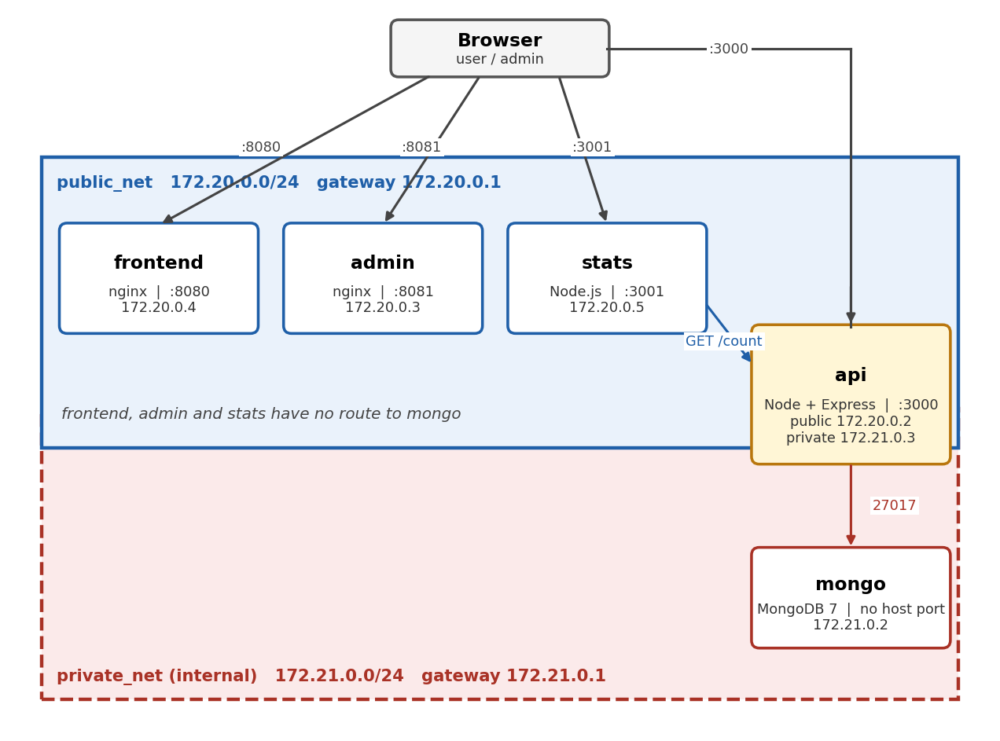
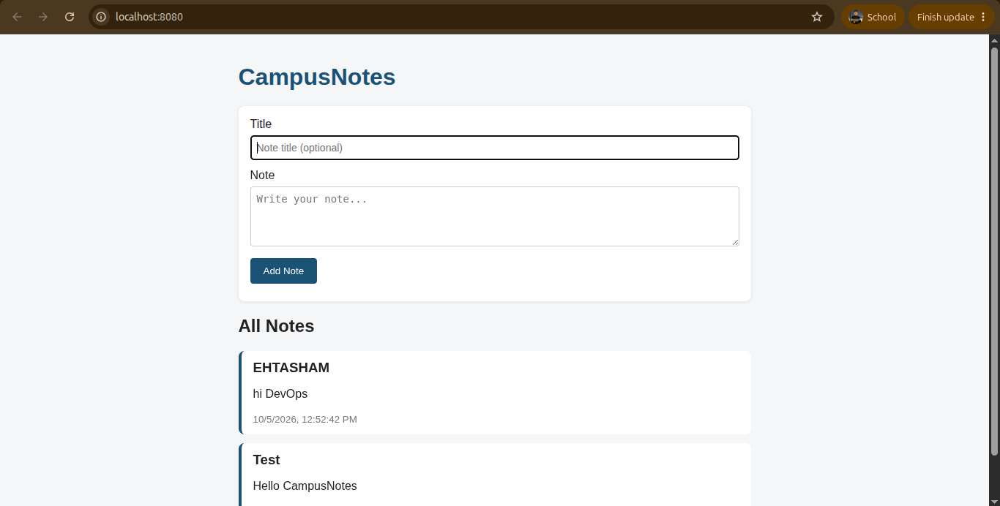
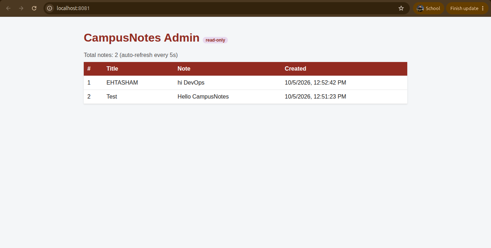
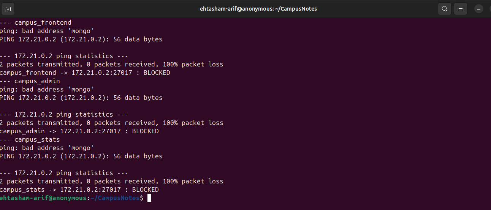
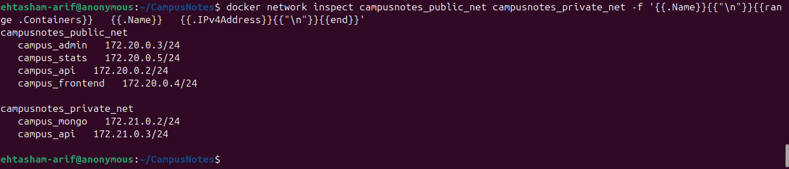

# CampusNotes: Docker Network Isolation

[](https://github.com/Ehtasham-Arif01/campusnotes-docker-networks/actions/workflows/compose-ci.yml)


A small notes app split into five containers, built to show **network segmentation with Docker Compose**. The app has a public tier and a private tier. MongoDB sits on an `internal` network with no published ports. The only way to reach it is through the API, which is the one service attached to both networks.



## Highlights

- **Two user-defined bridge networks** with fixed subnets and gateways
- **`internal: true` private network**: the database has no route to the host or the internet
- **No published ports on MongoDB**: it can't be reached from your machine
- **API as the single gateway** between the public and private tiers
- **Service discovery over Docker DNS** (`api`, `mongo`) instead of hard-coded IPs
- **Healthchecks plus `depends_on: service_healthy`** so services start in order
- **Non-root Node containers**, small Alpine images, a persistent named volume

## Architecture

| Service    | Image / Build      | Host port | `public_net` (172.20.0.0/24) | `private_net` (172.21.0.0/24, internal) |
|------------|--------------------|-----------|:----------------------------:|:---------------------------------------:|
| `frontend` | nginx (static)     | 8080      | ✅ | ❌ |
| `admin`    | nginx (static)     | 8081      | ✅ | ❌ |
| `stats`    | Node.js / Express  | 3001      | ✅ | ❌ |
| `api`      | Node.js / Express  | 3000      | ✅ | ✅ |
| `mongo`    | `mongo:7`          | none      | ❌ | ✅ |

```
         Browser / Host
   ┌────────┼─────────┬─────────┐
 :8080    :8081     :3001     :3000
   │        │         │         │
┌──┴──────┬─┴──────┬──┴─────┬───┴──┐   public_net (bridge)
│frontend │ admin  │ stats ─┼─► api│   172.20.0.0/24
└─────────┴────────┴────────┴───┬──┘
                                │
                         ┌──────┴──────┐ private_net (bridge, internal)
                         │    mongo    │ 172.21.0.0/24
                         └─────────────┘ no published ports
```

## Getting started

**Requirements:** Docker Engine 24+ with the Compose v2 plugin.

```bash
git clone https://github.com/Ehtasham-Arif01/campusnotes-docker-networks.git
cd campusnotes-docker-networks/CampusNotes
docker compose up -d --build --wait
```

| URL                          | What it is                                 |
|------------------------------|--------------------------------------------|
| http://localhost:8080        | Frontend: write and browse notes           |
| http://localhost:8081        | Admin: read-only table, refreshes every 5s |
| http://localhost:3000/notes  | API: list notes (JSON)                     |
| http://localhost:3001/stats  | Stats service (JSON)                       |

To stop the stack:

```bash
docker compose down        # keep data
docker compose down -v     # also delete the MongoDB volume
```

## API reference

| Method | Path      | Description                                                       |
|--------|-----------|-------------------------------------------------------------------|
| GET    | `/health` | Liveness check plus MongoDB connection state                      |
| GET    | `/notes`  | All notes, newest first                                           |
| POST   | `/notes`  | Create a note: `{ "title": "optional", "text": "required" }`      |
| GET    | `/count`  | `{ "total_notes": n }`                                            |

```bash
curl -X POST http://localhost:3000/notes \
  -H 'Content-Type: application/json' \
  -d '{"title":"DevOps","text":"Internal networks block outbound traffic."}'
```

Database routes return `503` until MongoDB is reachable and `400` for invalid input. The title can be up to 120 characters and the text up to 5000.

## Verifying the isolation

```bash
# Subnets and gateways
docker network inspect campusnotes_public_net campusnotes_private_net \
  --format '{{.Name}}: {{range .IPAM.Config}}{{.Subnet}} gw {{.Gateway}}{{end}} internal={{.Internal}}'

# Which containers are on which network
docker network inspect campusnotes_public_net  --format '{{range .Containers}}{{.Name}} {{end}}'
docker network inspect campusnotes_private_net --format '{{range .Containers}}{{.Name}} {{end}}'

# ✅ The API can reach MongoDB
docker exec campus_api wget -qO- -T 3 http://mongo:27017

# ❌ A public-only service can't even resolve it
docker exec campus_stats wget -qO- -T 3 http://mongo:27017   # -> bad address 'mongo:27017'

# ❌ MongoDB isn't published on the host
docker port campus_mongo                                     # -> (no output)
```

The `screenshots/` folder contains the captured output of each check, and the full write-up is in [`23P-0567_CampusNotes_Report.pdf`](23P-0567_CampusNotes_Report.pdf).

| | |
|---|---|
|  |  |
|  |  |

## Project structure

```
.
├── CampusNotes/
│   ├── docker-compose.yml   # services, networks, volume
│   ├── api/                 # Express + MongoDB driver (public + private)
│   ├── stats/               # Express, calls the API (public only)
│   ├── frontend/            # Static nginx page (public only)
│   └── admin/               # Static nginx read-only view (public only)
├── screenshots/             # Evidence for every verification step
└── 23P-0567_CampusNotes_Report.pdf
```

## Configuration

| Variable    | Service | Default                   |
|-------------|---------|---------------------------|
| `MONGO_URL` | api     | `mongodb://mongo:27017`   |
| `DB_NAME`   | api     | `campusnotes`             |
| `PORT`      | api     | `3000`                    |
| `API_URL`   | stats   | `http://api:3000`         |
| `PORT`      | stats   | `3001`                    |

> **Note:** This is a teaching project. MongoDB runs without authentication, which is acceptable only because it's on an isolated internal network. Enable auth and add TLS before using this pattern anywhere real.

## License

[MIT](LICENSE)
